# 🤖 Eric Leite

**`Programador`**

Me chamo Eric Delefrati Rocha Leite, tenho 20 anos e sou natural do Paraná. Concluí o ensino médio no Colégio Alfa Tesla. Atualmente, estou cursando Engenharia de Software na Unicesumar. Amante de tudo que envolve o mundo da computação e tecnologia. Acessa meu site no Neocities: https://themediabunker.neocities.org/

    

---

### 💻 Linguagens e Tecnologias

 
 

---

### 📊 Estatísticas

  
  

  

### 🐱‍💻 Commits

  <picture>
    <source media="(prefers-color-scheme: dark)" srcset="https://raw.githubusercontent.com/EricDRL/EricDRL/output/pacman-contribution-graph-dark.svg">
    <source media="(prefers-color-scheme: light)" srcset="https://raw.githubusercontent.com/EricDRL/EricDRL/output/pacman-contribution-graph.svg">
    
  </picture>

